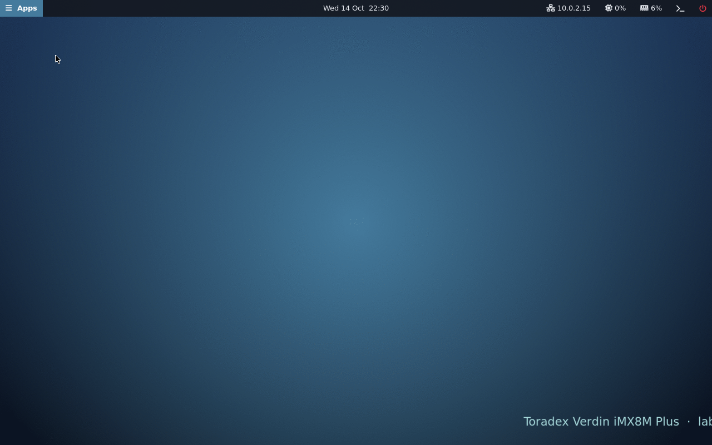
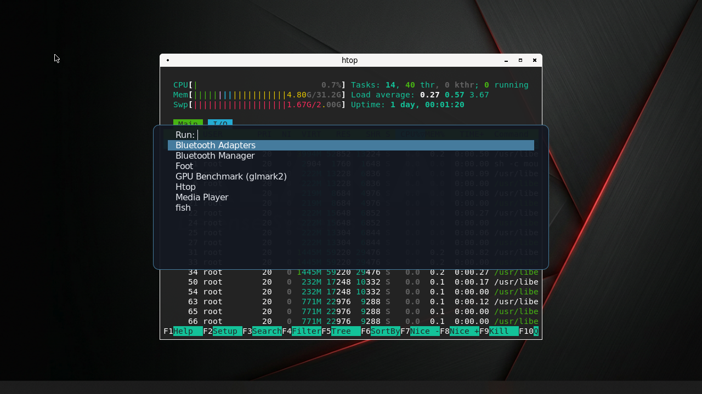

# labwc desktop for Toradex Verdin iMX8M Plus on Mallow

[](https://github.com/Nat-As/verdin-imx8mp-labwc/actions/workflows/build.yml)
[](https://github.com/Nat-As/verdin-imx8mp-labwc/releases)
[](https://github.com/Nat-As/verdin-imx8mp-labwc/releases)
[](LICENSE)

A Yocto image, built from source on the Toradex BSP 7.7.0, that boots a **Verdin iMX8M Plus** on
the **Mallow** carrier board straight into a minimal **labwc** Wayland desktop. labwc runs directly
on DRM/KMS, with no X11 or Xwayland, and renders on the GPU (Vulkan or OpenGL ES). The desktop
shows on the **Toradex Capacitive Touch Display 7" DSI** (1024x600, touch enabled) and on HDMI.

The image includes the complete GPU, NPU and VPU stack of the i.MX 8M Plus (Vulkan, OpenGL ES,
OpenCL, OpenVX, G2D, TensorFlow Lite with the NPU delegate, hardware video codecs), so it can be
used as the base for GUI- and machine-learning-heavy applications.

| | Included |
|---|---|
| Desktop | labwc 0.7.1 (wlroots 0.17.2), GPU rendered (Vulkan or GLES2), waybar panel, fuzzel launcher, foot terminal, swaybg wallpaper |
| GPU | Vivante GC7000UL: Vulkan, OpenGL ES, EGL/GBM, OpenCL, G2D (2D blitter), `vulkaninfo`, `clinfo`, `glmark2`, `gmem_info` |
| NPU | 2.3 TOPS NPU: OpenVX with NN extensions, RapidOpenVX, TIM-VX, TensorFlow Lite 2.16 (C++ and Python `tflite_runtime`) with the VX delegate |
| Video | Hantro VPU (H.264/H.265/VP9 decode, H.264/H.265 encode) with GStreamer plugins |
| Shell | fish (default for the terminal, SSH and the console), bash |
| Networking | NetworkManager (`nmtui`, `nmcli`), Bluetooth (BlueZ, Blueman), SSH server (dropbear) |
| Tools | nano, neofetch, htop, tmux, tree, git, curl, wget, rsync, nmap, gzip, man (with man pages) |
| Development | gcc/g++, make, cmake, meson, ninja, gdb, and headers for every installed library (incl. Wayland) |
| Python 3.12 | numpy, scipy, pandas, matplotlib, OpenCV (with OpenCL), TensorFlow Lite, Pillow, PyQt6, tkinter, pip, the full standard library |
| Qt | Qt 6.11 (Qt Base, Wayland, Declarative/QML, SVG) |
| Drivers | All drivers of the Toradex kernel (Mallow peripherals, 7" DSI display, Wi-Fi/Bluetooth), Realtek r8152 USB Ethernet |

## Download and install

**Pre-release v0.1.0:**
**[⬇ Verdin-iMX8MP_labwc-Demo-Image-Tezi_v0.1.0.tar](https://github.com/Nat-As/verdin-imx8mp-labwc/releases/download/v0.1.0/Verdin-iMX8MP_labwc-Demo-Image-Tezi_v0.1.0.tar)** (458 MB)

SHA-256: `4030d71c359d1484022a803ef39efa0ef0923c60469159171f59d79608f1e991`
([checksum file](https://github.com/Nat-As/verdin-imx8mp-labwc/releases/download/v0.1.0/Verdin-iMX8MP_labwc-Demo-Image-Tezi_v0.1.0.tar.sha256),
[release notes](https://github.com/Nat-As/verdin-imx8mp-labwc/releases/tag/v0.1.0),
[all releases](https://github.com/Nat-As/verdin-imx8mp-labwc/releases))

Install it with [Toradex Easy Installer](https://developer.toradex.com/easy-installer/toradex-easy-installer/) (Tezi):

1. Start the module in Tezi ([recovery mode](https://developer.toradex.com/hardware/hardware-resources/recovery-mode/imx-recovery-mode/)).
2. Extract the tarball onto a FAT32 or ext4 formatted USB stick or SD card:
   ```sh
   tar -xf Verdin-iMX8MP_labwc-Demo-Image-Tezi_v0.1.0.tar -C /media/<stick>/
   ```
3. Plug the stick into the Mallow board. Tezi lists **"Toradex Embedded Linux labwc Demo Image"**.
4. Select it, click **Install**, accept the NXP EULA, and click **Reboot** when it finishes.

The board boots into the labwc desktop on the 7" DSI display and the HDMI output. The Mallow device
tree and the display overlays are selected automatically.

<details>
<summary>Installing over the network instead of a USB stick</summary>

1. Extract the tarball on a PC and serve the folder that contains it:
   `python3 -m http.server 8000`
2. In Tezi, open **Feeds** and add
   `http://<pc-ip>:8000/Verdin-iMX8MP_labwc-Demo-Image-Tezi_<version>/image.json`, then install as above.

</details>

## Build

Requirements: an Ubuntu 22.04 host with the
[Yocto host packages](https://docs.yoctoproject.org/5.0/ref-manual/system-requirements.html#ubuntu-and-debian)
and [`repo`](https://gerrit.googlesource.com/git-repo) installed, and about 150 GB of free disk. The first build
takes several hours (it compiles the toolchain, Qt 6, OpenCV, SciPy and TensorFlow Lite from source).

```sh
git clone https://github.com/Nat-As/verdin-imx8mp-labwc.git
cd verdin-imx8mp-labwc
./setup.sh      # fetch the Toradex BSP 7.7.0, meta-wayland, meta-qt6 and NXP meta-imx-ml
./build.sh      # build labwc-demo-image (log: build-logs/latest.log)
```

The Tezi tarball is written to:

```
build/deploy/images/verdin-imx8mp/Verdin-iMX8MP_labwc-Demo-Image-Tezi.tar
```

### Customize the software

The software in the image is listed in two config files. Edit them and run `./build.sh` again:

| File | Contents |
|---|---|
| [`config/image-packages.conf`](config/image-packages.conf) | Applications, tools, networking, development tools, Qt, drivers, and packages to leave out |
| [`config/python-packages.conf`](config/python-packages.conf) | Python libraries |

Entries are Yocto package names, one per line. To find a package, search the
[OpenEmbedded layer index](https://layers.openembedded.org/layerindex/branch/scarthgap/recipes/)
(branch *scarthgap*). Packages are installed and configured when the image is built; there is no
separate setup step on the board. Python libraries that aren't packaged can be installed on the
board with `pip3 install --user <name>`.

Other customizations are in the `layers/meta-labwc-demo` layer (desktop configuration, wallpaper,
users) and in `build/conf/local.conf` (display overlays, build settings). Rebuilds after a change
take a few minutes to an hour, depending on what changed.

## Screenshots



*The desktop after boot: wallpaper and waybar panel.*



*The fuzzel launcher and a foot terminal running htop.*

## Log in

| User | Password | Notes |
|---|---|---|
| `argos_user` | `argos_user` | Desktop user: the desktop runs as this user. Can power off and reboot. |
| `alakai_admin` | `alakai_admin` | Administrator: use `sudo` for system tasks. |

Direct `root` login is disabled. Run administrative commands as `alakai_admin` with `sudo`, or get a
root shell with `sudo -i`. The login shell of the accounts is **fish**; run `bash` for a POSIX shell,
or change it with `chsh -s /bin/bash`.

SSH is enabled. The board gets an address over DHCP on Ethernet (or Wi-Fi, see below):

```sh
ssh argos_user@<board-ip>
ssh alakai_admin@<board-ip>
```

The hostname is `verdin-imx8mp-<serial-number>`, and mDNS is enabled, so
`ssh argos_user@verdin-imx8mp-<serial-number>.local` also works.

> **Change both passwords** (`passwd`) before connecting the board to anything other than a lab
> network.

## Use the desktop

| Action | How |
|---|---|
| Open the application launcher | **Apps** button on the panel, or **Super+D** |
| Open a terminal | Terminal icon on the panel, or **Super+Return** |
| Network settings (Ethernet, Wi-Fi) | Click the network status on the panel (opens `nmtui`) |
| Bluetooth devices | Click the Bluetooth icon on the panel (opens Blueman) |
| Desktop menu (terminal, apps, htop, network, Bluetooth, restart session, reboot, power off) | Right-click the desktop, or **Super+M** |
| Close a window | **Super+Q** or **Alt+F4** |
| Switch windows | **Alt+Tab** |
| Power off / reboot | Power icon on the panel (left click: power off, right click: reboot) |

The touchscreen is enabled (tap to select and click). A keyboard and mouse can be plugged in at any
time.

To start GUI programs over SSH, log in as `argos_user` while the desktop is running, then run them
(for example `foot &`).

### Python and Qt

```sh
python3 -c "import numpy, scipy, pandas, matplotlib, cv2; print(cv2.__version__)"
```

Plots from matplotlib and windows from PyQt6 or Qt 6 C++ programs open as Wayland windows on the
desktop. tkinter is installed, but Tk is an X11 toolkit, so tkinter windows need an X server
(Xwayland), which this image doesn't run.

### GPU and NPU

Check the hardware acceleration (GPU renderer, Vulkan, OpenCL, OpenVX, NPU, G2D, VPU, display,
touch, audio, RTC, Wi-Fi, Bluetooth, Ethernet), as `alakai_admin`:

```sh
sudo labwc-hwaccel-check        # add -q to skip the NPU benchmark
```

**Desktop renderer.** labwc tries these renderers in order and uses the first one that works;
a renderer that crashes or reports errors during startup is skipped until the next reboot:

| Strategy | Renderer |
|---|---|
| `vulkan` | Vulkan on the GPU |
| `gles2` | OpenGL ES 2 on the display device (the way Weston uses the GPU) |
| `gles2-render` | OpenGL ES 2 on the GPU render node |
| `pixman` | Software rendering on the CPU (slow; last resort) |

The renderer in use is shown by `labwc-hwaccel-check` and in the desktop log
(`sudo journalctl -b -t labwc | grep -E "labwc-session|renderer"`). To change the order, for
example to prefer OpenGL ES, set `LABWC_RENDERERS="gles2 gles2-render vulkan pixman"` in
`/etc/default/labwc` and run `sudo systemctl restart labwc`.

`sudo labwc-gpu-probe` starts labwc once per renderer (off-screen, the desktop keeps running) and
prints which ones work, with a gdb backtrace for any crash. `sudo labwc-gpu-probe --kms` does the
same on the real displays (the desktop is stopped for about a minute).

**NPU.** TensorFlow Lite models run on the NPU through the VX delegate
(`/usr/lib/libvx_delegate.so`):

```sh
cd /usr/bin/tensorflow-lite-2.16.2/examples
./label_image -m mobilenet_v1_1.0_224_quant.tflite -i grace_hopper.bmp -l labels.txt \
    --external_delegate_path=/usr/lib/libvx_delegate.so
```

```python
import tflite_runtime.interpreter as tflite
npu = tflite.load_delegate("/usr/lib/libvx_delegate.so")
interpreter = tflite.Interpreter(model_path="model.tflite", experimental_delegates=[npu])
```

The first inference compiles the model for the NPU and takes a few seconds. To cache the compiled
graph between runs, set `VIV_VX_ENABLE_CACHE_GRAPH_BINARY=1` and
`VIV_VX_CACHE_BINARY_GRAPH_DIR=<writable directory>`. Quantized (int8/uint8) models run fastest
on the NPU. C/C++ programs can use OpenVX (`<VX/vx.h>`, `-lOpenVX`), RapidOpenVX or TIM-VX
directly; the headers are installed.

**OpenCL and OpenCV.** OpenCV uses the GPU through OpenCL for `cv::UMat` operations
(`cv2.UMat` in Python). Check it with
`python3 -c "import cv2; print(cv2.ocl.haveOpenCL(), cv2.ocl.Device.getDefault().name())"`.
Programs that need GPU access (`/dev/galcore`) must run as a member of the `video` group (the
desktop user is) or as root.

### Configuration

| What | Where |
|---|---|
| Keyboard shortcuts, window behaviour, menu, autostart, touchscreen | `/etc/xdg/labwc/` (per user: `~/.config/labwc/`) |
| Panel | `/etc/xdg/waybar/` (per user: `~/.config/waybar/`) |
| Terminal and launcher | `/etc/xdg/foot/foot.ini`, `/etc/xdg/fuzzel/fuzzel.ini` |
| fish | `/etc/fish/` (per user: `~/.config/fish/`) |
| Session settings (renderer order, debug logging) | `/etc/default/labwc` |
| Display overlays | `/boot/overlays.txt` (reboot after a change) |

After a desktop configuration change, select **Restart session** in the desktop menu, or run
`sudo systemctl restart labwc` as `alakai_admin`.

### Troubleshooting

System commands below need `sudo`, so run them as `alakai_admin`.

- **Show the desktop log:** `sudo journalctl -b -t labwc`
- **Black or garbled screen, or windows drawn wrong:** try the next renderer. Add
  `LABWC_RENDERERS="gles2 gles2-render pixman"` (or `WLR_RENDERER=pixman` for software rendering)
  to `/etc/default/labwc`, then run `sudo systemctl restart labwc`. Please report it with the
  output of `sudo labwc-gpu-probe`.
- **The 7" display stays dark:** `labwc-hwaccel-check` reports `touch FAIL` when the display does
  not answer on I2C (kernel log: `sn65dsi83 ... failed to lock PLL` and
  `ilitek_ts ... protocol init failed`). Check the display's FFC cable and power. While the display
  is missing and HDMI is connected, the desktop turns the 7" output (`LVDS-1`) off so that windows
  don't open on an invisible screen.
- **Wrong date and time after power-up:** the kernel log shows `rtc-ds1307 ... oscillator failed`
  when the Mallow board's RTC backup battery is missing or empty. The clock is set from the network
  (NTP) once the board is online; insert a coin cell to keep the time without power.
- **Touch input lands in the wrong place with HDMI also connected:** touch is mapped to the 7"
  display (output `LVDS-1`). Check the output names with `wlr-randr` and adjust
  `<touch mapToOutput="..."/>` in `/etc/xdg/labwc/rc.xml`.
- **Using the Toradex DSI-to-HDMI adapter instead of the 7" display:** in `/boot/overlays.txt`, replace
  `verdin-imx8mp_panel-cap-touch-7inch-dsi_overlay.dtbo` with
  `verdin-imx8mp_dsi-to-hdmi_overlay.dtbo` and reboot.
- **Return to the text console:** `sudo systemctl stop labwc`

### Expected kernel messages

These boot messages are harmless on this hardware: `Fixed dependency cycle(s)`,
`supply ... not found, using dummy regulator`, `imx-bus-devfreq ... failed to fetch clk: -2`,
`fsl-aud2htx ... failed to pcm register` (the HDMI audio driver retries and succeeds),
`No soundcards found` (printed before the sound drivers load), `imx6q-pcie ... Phy link never came
up` (nothing in the PCIe slot), `tpm tpm0: A TPM error (256) ... starting up the TPM manually`,
`mwifiex_sdio ... unknown event id: 0x81` / `Unknown GET_HW_SPEC TLV type`,
`mwifiex_cfg80211_sched_scan_start : Invalid Sched_scan parameters` (background Wi-Fi scans fall
back to normal scans), `Hot alarm is canceled. GPU3D clock will return to 64/64`,
`memfd_create() called without MFD_EXEC` and a short USB disconnect/reconnect of the devices
behind the Mallow USB hub while its driver initializes it.

## License

This repository is released under the [MIT License](LICENSE).

The image also contains third-party software under its own licenses, including GPL/LGPL components and
NXP proprietary GPU/VPU firmware and libraries under the NXP Software License Agreement, which
Tezi shows before installing. License texts for every package are installed in
`/usr/share/common-licenses/` on the board.
